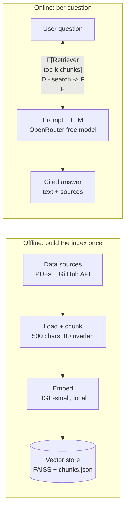

# MeRAG

A personal RAG (Retrieval-Augmented Generation) system that answers questions about my professional background (CV, LinkedIn, GitHub projects) and cites the source of every answer.

Ask a question like *"Where did he intern and what did he work on?"* and MeRAG retrieves the most relevant passages from my own documents, lets an LLM write the answer **using only those passages**, and shows which file or repo each fact came from.

## How it works



1. **Load**: PDFs (CV, LinkedIn export) are read page by page with PyMuPDF. Public GitHub repos and their READMEs are fetched through the GitHub API.
2. **Chunk**: text is cleaned and split into ~500-character overlapping chunks. Every chunk keeps its metadata (`source`, `page`, `type`, `chunk_id`), which is what makes citations possible.
3. **Embed + store**: each chunk is turned into a vector with a small local embedding model and saved in a FAISS index. The chunk texts and metadata are saved next to it in `chunks.json`, in the same order.
4. **Retrieve**: the question is embedded with the same model and FAISS returns the closest chunks.
5. **Answer**: the retrieved chunks are numbered `[1]`, `[2]`, ... and sent to the LLM with the rule "answer only from these passages, cite by number". The citation numbers are mapped back to real sources (for example `CV.pdf, p.1` or a repo URL).

## Tech stack

| Job | Tool |
|---|---|
| PDF reading | PyMuPDF |
| GitHub data | GitHub REST API (`requests`) |
| Chunking | LangChain text splitters |
| Embeddings | `BAAI/bge-small-en-v1.5` via sentence-transformers (local, free) |
| Vector search | FAISS (`IndexFlatIP`, cosine similarity) |
| LLM | OpenRouter free models (OpenAI-compatible API) |
| UI | Streamlit (planned) |

## Project structure

```
MeRAG/
├── data/
│   └── raw/                 # your own PDFs go here (gitignored)
│       └── github/          # auto-generated copies of fetched READMEs
├── src/
│   ├── loader.py            # read PDFs + fetch GitHub repos -> Documents
│   ├── chunking.py          # clean text, split into chunks, keep metadata
│   ├── vectordb_creation.py # embed chunks, build/load FAISS index, search()
│   └── qa.py                # retrieve + prompt LLM + format citations
├── vectorstore/             # generated index + chunks.json (gitignored)
├── .env.example
├── requirements.txt
└── README.md
```

## Setup

**1. Clone and create a virtual environment**

```bash
git clone https://github.com/ammar-abdelghany30/MeRAG.git
cd MeRAG
python -m venv .venv
# Windows: .venv\Scripts\activate    |    macOS/Linux: source .venv/bin/activate
```

**2. Install dependencies**

```bash
pip install pymupdf requests python-dotenv langchain-core langchain-text-splitters faiss-cpu sentence-transformers numpy openai
```

**3. Configure environment variables**

Copy `.env.example` to `.env` and fill it in:

```
OPENROUTER_API_KEY=sk-or-v1-...
OPENROUTER_MODELS=<free-model-id-1>,<free-model-id-2>
GITHUB_USERNAME=your-github-username
GITHUB_TOKEN=            # optional, only raises the GitHub rate limit
```

Get a free key at [openrouter.ai/keys](https://openrouter.ai/keys). Pick model IDs ending in `:free` from the [model list](https://openrouter.ai/models); list a few so there are fallbacks, because the free lineup changes over time.

**4. Add your documents**

Put your CV and LinkedIn export (LinkedIn: *More -> Save to PDF*) in `data/raw/`:

```
data/raw/
├── cv.pdf
└── linkedin.pdf
```

## Usage

Run each step from the repo root.

```bash
# (optional) check that loading and chunking work
python -m src.loader
python -m src.chunking

# build the vector index (run again whenever your documents change)
python -m src.vectordb_creation

# ask questions in the terminal
python -m src.qa
```

Example session:

```
Ask about me (or 'quit'): Where did he intern and what did he work on?

<answer written from the retrieved passages, with [1], [2] citations>

Sources:
 - CV.pdf, p.1
 - linkedin.pdf, p.1
```

`qa.answer(question)` returns `{"answer": str, "sources": [str, ...]}`, so any UI can call it directly.

## Design notes

- **Sources never come from the LLM.** Citation labels are built from chunk metadata, so the model cannot invent a source.
- **Retrieval ignores the name in the question.** Words like the owner's name are stripped before embedding, because they otherwise pull in header and contact chunks instead of the content being asked about. The original question still goes to the LLM.
- **Index and chunk file must stay in sync.** Vector *i* in FAISS corresponds to record *i* in `chunks.json`; both are written together by `build_index()`. Rebuild the index whenever you change the embedding model.
- **Forks are skipped** when fetching GitHub repos, so answers describe only my own projects.

## Privacy

This repo is public, but my personal data is not. `data/` (raw CV, LinkedIn export, fetched READMEs), `vectorstore/` (which contains readable chunk text), and `.env` are all gitignored. To try the project, add your own documents to `data/raw/`.

## Status and roadmap

- [x] Document loading (PDFs + GitHub API)
- [x] Chunking with source metadata
- [x] Embeddings + FAISS index + semantic search
- [x] LLM answering with source citations (terminal)
- [ ] Streamlit app
- [ ] Small retrieval test set (sample questions with expected sources)
- [ ] Section labels on chunks and simple source filters (for example, "GitHub" questions search only repos)
- [ ] Optional reranking of retrieved chunks

## License

MIT
