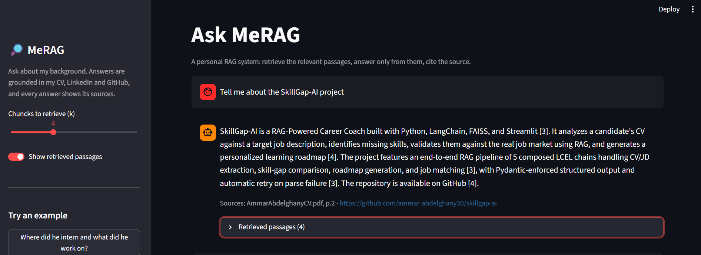
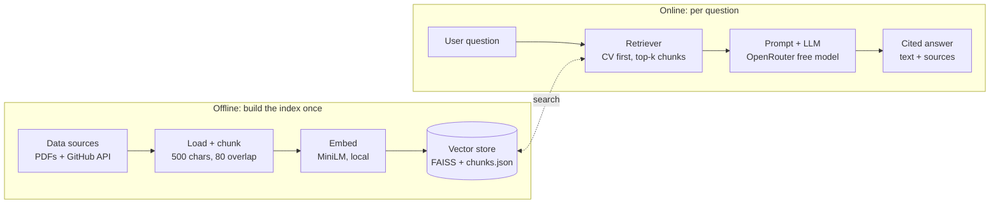

# MeRAG

A personal RAG (Retrieval-Augmented Generation) system that answers questions about my professional background (CV, LinkedIn, GitHub projects) and cites the source of every answer.

Ask a question like *"Where did he intern and what did he work on?"* and MeRAG retrieves the most relevant passages from my own documents, lets an LLM write the answer **using only those passages**, and shows which file or repo each fact came from.



## What is RAG, in plain words

A plain LLM answers from what it memorized in training, so it knows nothing about my CV and may invent details. RAG fixes this in three steps:

1. **Retrieve**: search my own documents for the passages most related to the question.
2. **Augment**: put those passages in front of the LLM.
3. **Generate**: the LLM writes the answer using only that material, and the answer points back to its sources.

Think of an open-book exam: the model isn't asked to remember my background, only to read the right pages and answer from them.

## How it works



**Offline (run once, and again whenever the documents change)**

1. **Load**: PDFs (CV, LinkedIn export) are read page by page with PyMuPDF. Public GitHub repos and their READMEs are fetched through the GitHub API (forks are skipped).
2. **Chunk**: text is cleaned and split into ~500-character overlapping chunks. Every chunk keeps its metadata (`source`, `page`, `type`, `chunk_id`), which is what makes citations possible.
3. **Embed + store**: each chunk is turned into a vector by a small local embedding model and saved in a FAISS index. The chunk texts and metadata are saved next to it in `chunks.json`, in the same order.

**Online (every question)**

4. **Retrieve**: the question is embedded with the same model and FAISS returns the closest chunks. The CV gets reserved slots (see below).
5. **Answer**: the retrieved chunks are numbered `[1]`, `[2]`, ... and sent to the LLM with the rule "answer only from these passages, cite by number, say so if the answer isn't there". Citation numbers are mapped back to real sources (for example `MyCV.pdf, p.1` or a repo URL).

## CV-first retrieval

The CV is the one source I wrote and checked myself, while GitHub READMEs are written for other readers and often outrank it by accident. So retrieval always favors the CV:

- Of the 6 passages sent to the LLM, the **3 best CV passages are reserved**. The other slots are filled by the best matches from all sources, with duplicates removed.
- The prompt tells the LLM that **if sources disagree, the CV wins**.

Both numbers are settings at the top of `src/qa.py`: `TOP_K` (total passages) and `CV_SLOTS` (reserved for the CV). Any PDF in `data/raw/` whose file name contains `cv` is treated as the CV (`CV_HINT`).

## Tech stack

| Job | Tool |
|---|---|
| PDF reading | PyMuPDF |
| GitHub data | GitHub REST API (`requests`) |
| Chunking | LangChain text splitters |
| Embeddings | `sentence-transformers/all-MiniLM-L6-v2` (local, free, 384 dimensions) |
| Vector search | FAISS (`IndexFlatIP`, cosine similarity) |
| LLM | OpenRouter free models (OpenAI-compatible API) |
| UI | Streamlit |

## Project structure

```
MeRAG/
├── data/
│   └── raw/                  # your own documents (gitignored)
│       ├── MyCV.pdf
│       ├── linkedin.pdf
│       └── github/           # auto-generated copies of fetched READMEs
├── src/
│   ├── loader.py             # read PDFs + fetch GitHub repos -> Documents
│   ├── chunking.py           # clean text, split into chunks, keep metadata
│   ├── vectordb_creation.py  # embed chunks, build/load FAISS index, search()
│   └── qa.py                 # CV-first retrieval + prompt LLM + citations
├── app.py                    # Streamlit web app
├── Research tasks/           # separate experiments, unrelated to the RAG pipeline
├── vectorstore/              # generated index + chunks.json (gitignored)
├── .env.example
├── requirements.txt
└── README.md
```

## Setup

**1. Clone and create a virtual environment**

```bash
git clone https://github.com/ammar-abdelghany30/MeRAG.git
cd MeRAG
python -m venv .venv
# Windows: .venv\Scripts\activate    |    macOS/Linux: source .venv/bin/activate
```

**2. Install dependencies**

```bash
pip install pymupdf requests python-dotenv langchain-core langchain-text-splitters faiss-cpu sentence-transformers numpy openai streamlit
```

**3. Configure environment variables**

Copy `.env.example` to `.env` (in the repo root, next to this README) and fill it in:

```
OPENROUTER_API_KEY=sk-or-v1-your-real-key
OPENROUTER_MODELS=<free-model-id-1>,<free-model-id-2>
GITHUB_USERNAME=your-github-username
GITHUB_TOKEN=
```

- Get a free key at [openrouter.ai/keys](https://openrouter.ai/keys).
- `OPENROUTER_MODELS` is required. Open the [model list](https://openrouter.ai/models), turn on the free filter, and **copy the exact IDs** (they end in `:free`). The first ID is used, and the others are fallbacks if it is busy or retired. The free lineup changes over time, so recopy an ID if you get a 400 or 404 error.
- `GITHUB_USERNAME` is the username only, not the profile link.
- `GITHUB_TOKEN` is optional and only raises the GitHub rate limit.
- No quotes and no spaces around `=`. Never commit `.env`.

**4. Add your documents**

Put your CV and LinkedIn export (LinkedIn: *More -> Save to PDF*) in `data/raw/`:

```
data/raw/
├── MyCV.pdf          # the file name must contain "cv" to get CV priority
└── linkedin.pdf
```

**5. Build the vector index**

```bash
python -m src.vectordb_creation
```

The first run downloads the embedding model (~90 MB) and then works offline. **Run this step again whenever your documents change or you change the embedding model.** Both the index and `chunks.json` are rewritten together, and they must always come from the same run.

## Usage

Run everything from the repo root.

**Web app (recommended)**

```bash
streamlit run app.py
```

This opens `localhost:8501` with:

- a chat interface with history,
- a **Sources** line under every answer,
- a **Retrieved passages** panel showing the exact chunks the LLM saw, their source, and their similarity score (useful for checking whether a wrong answer came from retrieval or from the LLM),
- a sidebar with a slider for how many passages to retrieve (k), example questions, and a Clear chat button.

**Terminal**

```bash
python -m src.qa
```

```
Ask about me (or 'quit'): Where did he intern and what did he work on?

<answer written from the retrieved passages, with [1], [2] citations>

Sources:
 - MyCV.pdf, p.1
 - linkedin.pdf, p.1
```

**From your own code**

```python
from src.qa import answer

out = answer("Does he know SQL?")
out["answer"]   # the text, with [n] citations
out["sources"]  # e.g. ["MyCV.pdf, p.1", "https://github.com/.../repo"]
out["chunks"]   # retrieved passages: label, score, text
```

**Debugging helpers (optional)**

```bash
python -m src.loader      # check that PDFs and GitHub repos load
python -m src.chunking    # check the chunk count and metadata
```

## Design notes

- **Sources never come from the LLM.** Citation labels are built from chunk metadata, so the model cannot invent a source.
- **The name is removed before searching.** Words like the owner's name are stripped from the query before embedding, because they otherwise pull in header and contact chunks instead of the content being asked about. The original question still goes to the LLM.
- **Index and chunk file stay in sync.** Vector *i* in FAISS corresponds to record *i* in `chunks.json`, and both are written together by `build_index()`. The same embedding model must be used for indexing and for questions.
- **One LLM request per question**, which keeps usage low on free-tier limits.


## Privacy

This repo is public, but my personal data is not. `data/` (raw CV, LinkedIn export, fetched READMEs), `vectorstore/` (which contains readable chunk text), and `.env` are all gitignored. To try the project, add your own documents to `data/raw/`. For demos, run the app locally rather than deploying it publicly.

## License

MIT
